# DeMAF Type Definitions

In this repository we provide the definitions of abstract component and relation types the DeMAF uses to create EDMM models either as

1. [EDMM Yaml files](edmm/)
1. or corresponding definitions of [TOSCA node types and relationship types](tosca/)

The DeMAF Type Definitions are loosely based on a mix of

1. the types defined in the [EDMM modeling repository](<https://github.com/UST-EDMM/modeling-repository>)
1. and the normative types of the TOSCA Simple Profile v1.3 as defined in the [Standard](https://docs.oasis-open.org/tosca/TOSCA-Simple-Profile-YAML/v1.3/os/TOSCA-Simple-Profile-YAML-v1.3-os.html#_Toc269694699) and the
[GitHub Repository](<https://github.com/OpenTOSCA/tosca-normative-types-repository>)

The DeMAF Type Definitions may be modified and extended in the future.

## Examples

We provide some examples of technology-specific deployment models and their corresponding EDMM model using the type system in [examples](examples/).
In examples/winery we provide TOSCA models generated from the EDMM models for importing and viewing them in Eclipse Winery.

## Component Types

The following diagram shows the Component Type hierarchy, including concrete types that may be generated by the DeMAF based on the input deployment model:

### Component Type Descriptions

- **Compute**: An infrastructural component that offers computing capabilities, such as a virtual machine (an EC2 instance) or a serverless function (a Lambda function). Concrete types follow DeMAF's standard `<token>-Compute` naming convention, such as `instance-Compute` for an EC2 instance and `lambda-Compute` for a Lambda function. Currently, these components connect directly to the cloud provider with nothing more specific in between. This may change if we add more detailed host information like VPC or subnet.
- **Platform**: This type includes managed platform services where the provider operates the underlying machine, operating system, and runtime. The user only supplies application code or configuration and does not control or need to model a separate host. Concrete types use the `<token>-Platform` naming convention, such as `elasticbeanstalk-Platform`, `apprunner-Platform`, and `amplify-Platform`. Like Compute, these components are hosted directly on the root CloudProvider component because none of the mapped services include an explicit host reference.

## Relation Types

The following diagram shows the Relation Type hierarchy:

