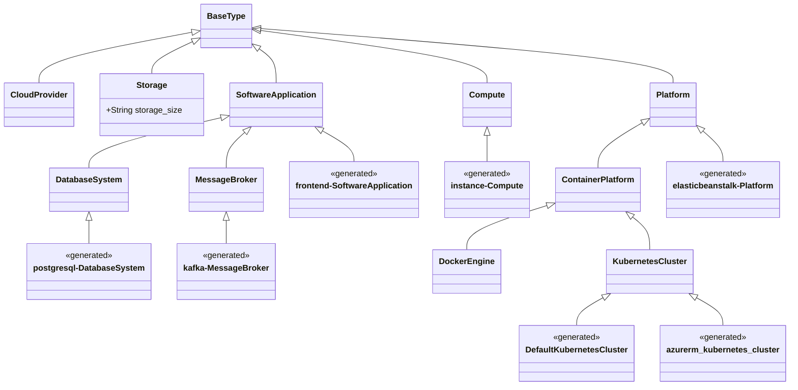
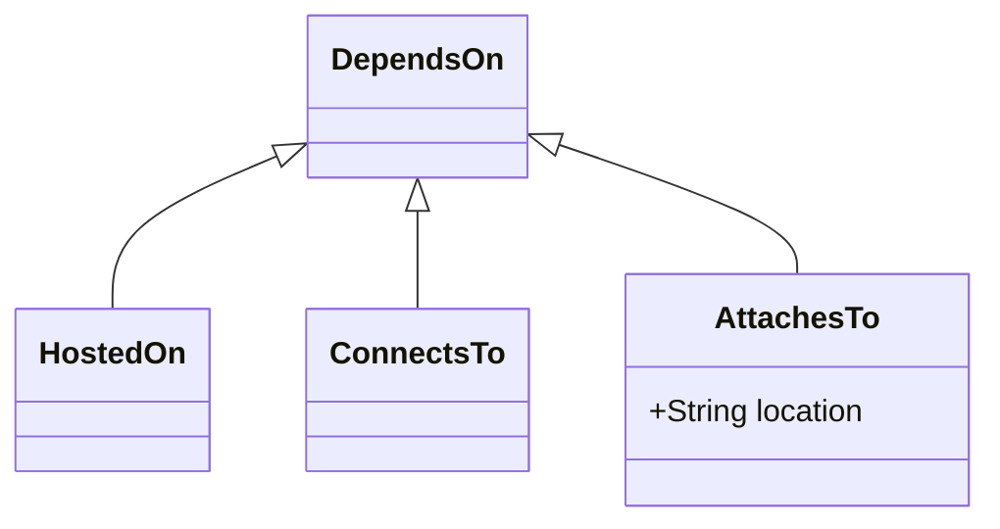
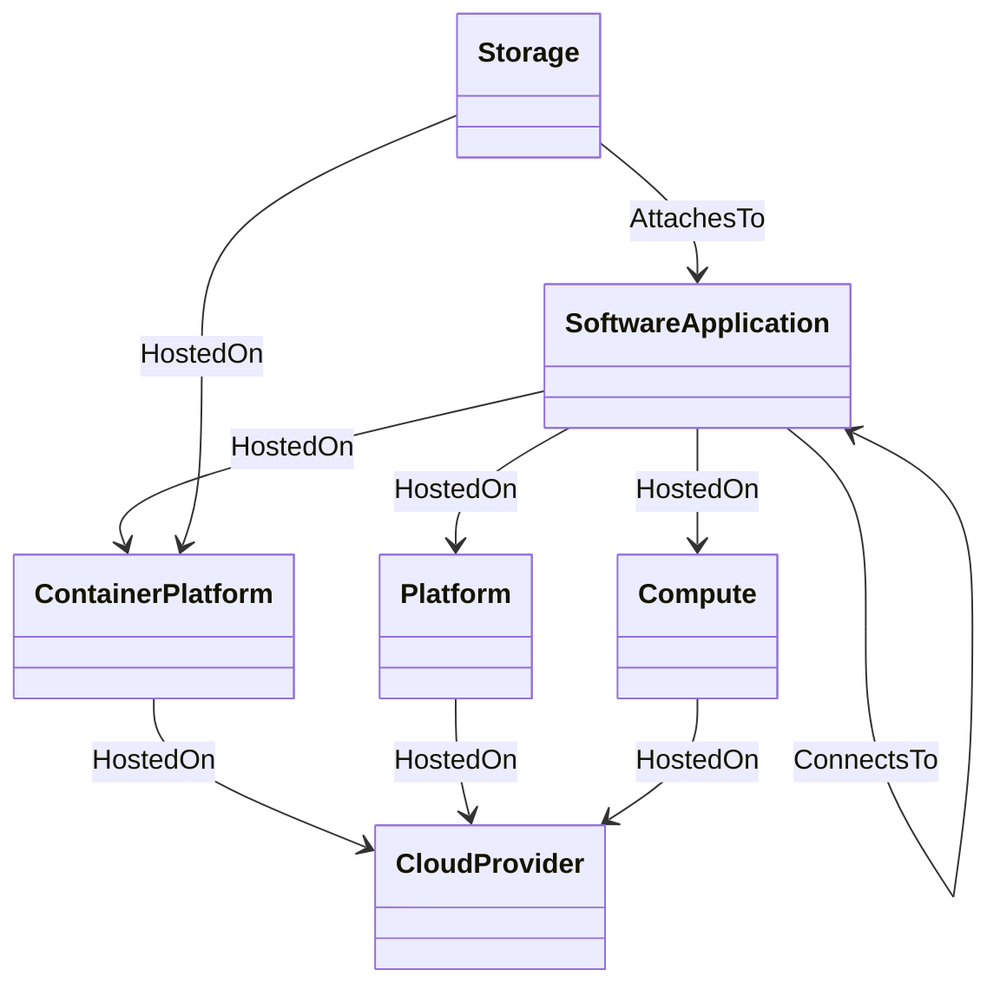

# DeMAF Type Definitions

In this repository we provide the definitions of abstract component and relation types the DeMAF uses to create EDMM models either as

1. [EDMM YAML files](edmm/)
1. or corresponding definitions of [TOSCA node types and relationship types](tosca/)

The DeMAF Type Definitions are loosely based on a mix of

1. the types defined in the [EDMM modeling repository](<https://github.com/UST-EDMM/modeling-repository>)
1. and the normative types of the TOSCA Simple Profile v1.3 as defined in the [Standard](https://docs.oasis-open.org/tosca/TOSCA-Simple-Profile-YAML/v1.3/os/TOSCA-Simple-Profile-YAML-v1.3-os.html#_Toc269694699) and the
[GitHub Repository](<https://github.com/OpenTOSCA/tosca-normative-types-repository>)

The DeMAF Type Definitions may be modified and extended in the future.

## Examples

We provide some examples of technology-specific deployment models and their corresponding EDMM model using the type system in [examples](examples/).
In examples/winery we provide TOSCA models generated from the EDMM models for importing and viewing them in Eclipse Winery.
The deployment models in the examples are based on third-party projects and are subject to their respective licenses, see [examples/README.md](examples/README.md).

## YAML Schema

In [yamlSchema](yamlSchema/) we provide a JSON Schema for the YAML serialization of the EDMM models created by the DeMAF and a script that checks EDMM models against it and further constraints.

## Component Types

The following diagram shows the component type hierarchy, with examples of concrete types (`<<generated>>`) that the DeMAF generates from the input deployment model:

Concrete types are named `<token>-<abstract type>`, where the token is, for example, the image name (`postgresql-DatabaseSystem`) or the AWS service (`elasticbeanstalk-Platform`), or after the resource type of the input deployment model (`azurerm_kubernetes_cluster`).
Optional properties may be added to the types.

### Component Type Descriptions

| Type | Parent | Description |
| --- | --- | --- |
| `BaseType` | – | The default component type from which all other component types derive. |
| `CloudProvider` | `BaseType` | The cloud infrastructure of a provider, on which cloud services and other resources are deployed on demand. |
| `Storage` | `BaseType` | A storage volume that is attached to a component and holds the component's data persistently. Property `storage_size`: the capacity of the storage volume. |
| `SoftwareApplication` | `BaseType` | Software that is deployed on another component and provides functionality to users or other components. |
| `DatabaseSystem` | `SoftwareApplication` | A system that stores and manages data and provides access to it through an interface. |
| `MessageBroker` | `SoftwareApplication` | An intermediary that receives messages from sending components and delivers them to receiving components. |
| `Compute` | `BaseType` | A physical or virtual machine on which any software can be deployed. |
| `Platform` | `BaseType` | A system on which other components are deployed in a form that the system defines, such as container images or application code, and which provides the resources that these components use. |
| `ContainerPlatform` | `Platform` | A platform on which components are deployed as containers. |
| `DockerEngine` | `ContainerPlatform` | A Docker Engine, on which components are deployed as Docker containers. |
| `KubernetesCluster` | `ContainerPlatform` | A set of machines, called nodes, managed by a Kubernetes control plane, on which components are deployed as pods. |

## Relation Types

The following diagram shows the relation type hierarchy:

### Relation Type Descriptions

| Type | Parent | Description |
| --- | --- | --- |
| `DependsOn` | – | The source component depends on the target component. This is the default relation type from which all other relation types derive. |
| `HostedOn` | `DependsOn` | The source component is deployed on the target component and uses resources that the target component provides. |
| `ConnectsTo` | `DependsOn` | The source component opens network connections to the target component to communicate with it. |
| `AttachesTo` | `DependsOn` | The source component provides storage that is attached to the target component at the path given by `location`. Property `location`: the path at which the storage is available to the component. |

### Relations Between Component Types

The following diagram shows how components of the abstract types are typically related:

